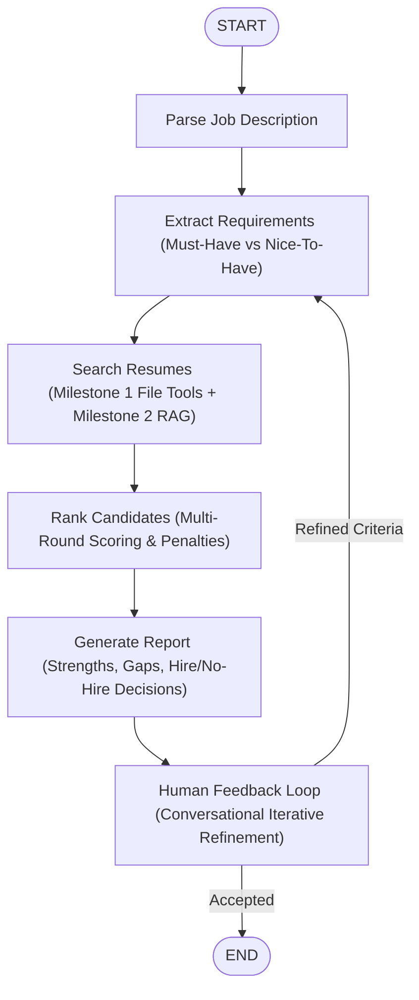

# Agent State Machine & Workflow Architecture

This document diagrams the complete LangGraph workflow powering the **Agentic Profile Matching** system.

---

## 1. State Machine Workflow Diagram

---

## 2. Multi-Round Screening Architecture

1. **Round 1: Broad Screening**:
   - Evaluates the total pool (30+ candidates) using dense semantic vector similarity and file system keyword filters.
   - Filters down to the top 10 most relevant candidates for deep evaluation.
2. **Round 2: Deep Evaluation & Criteria Matching**:
   - Strict evaluation against must-have criteria, secondary tech stack competencies, and minimum seniority requirements.
   - Computes weighted scores ($0 - 100$).
3. **Round 3: Recommendation & Decision Gate**:
   - `HIRE` (Score $\ge 75$): Candidate exceeds criteria with verified technical depth.
   - `BORDERLINE` ($50 \le \text{Score} < 75$): Missing specific non-core frameworks; improvement suggestions and technical screening questions provided.
   - `NO_HIRE` (Score $< 50$): Substantial gap in fundamental technical stack.
